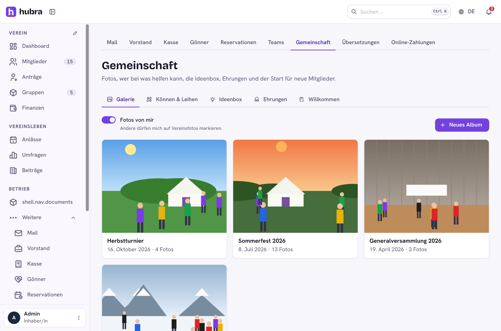
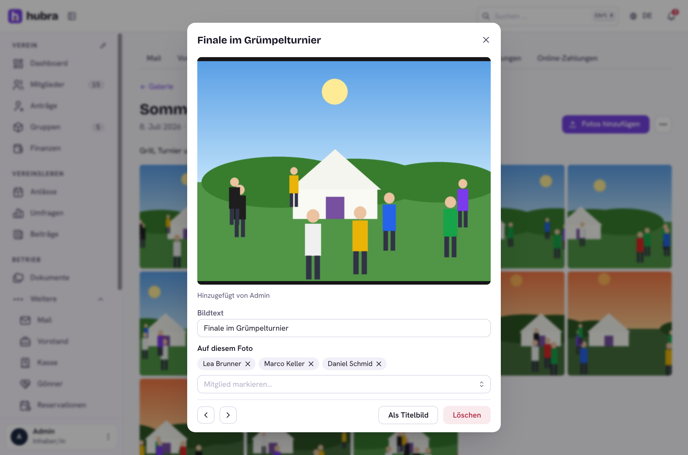
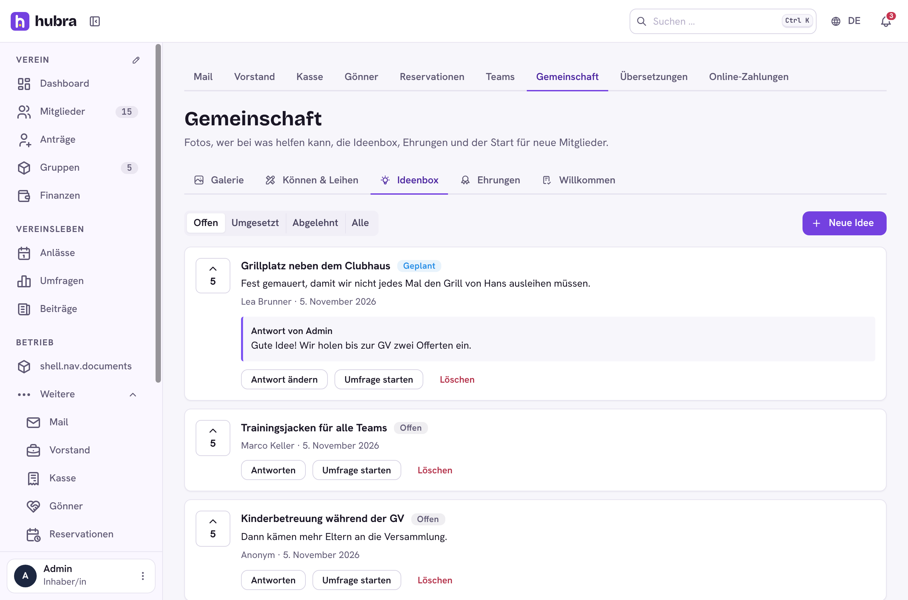
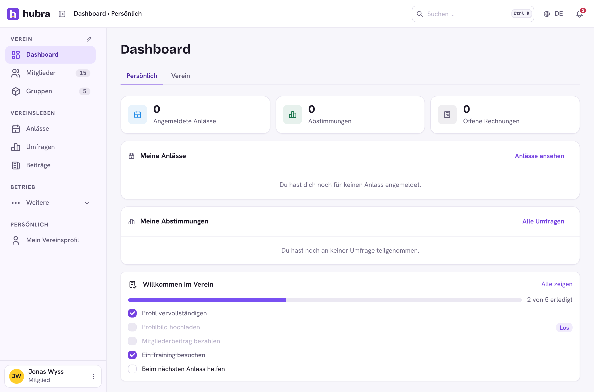
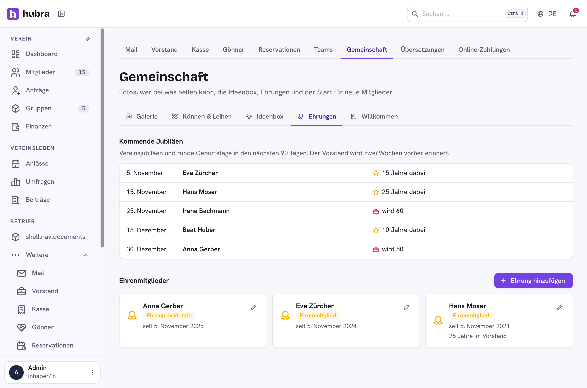

# Community

[](https://github.com/hubra-app/hubra-plugin-community/actions/workflows/release.yml?query=branch%3Amain) [](https://github.com/hubra-app/hubra-plugin-community/releases/latest) [](LICENSE)

A plugin for [Hubra](https://hubra.club). Member to member: photo albums that respect who doesn't want to be tagged, a skills and lending directory, an idea box with votes, a welcome checklist for new members, and jubilees and honorary members for the board.

**Version** 1.1.0 · **Works with** Hubra >=0.2,<1 · **Plugin id** `community` · **Needs** the members module (and polls, to turn ideas into polls; the file store, for photos)



## What it does

| Part | |
| --- | --- |
| Gallery | Albums per event. Members add photos to open albums (20 at a time); gallery managers create albums and can close one to members. Every photo is re-encoded on upload: location and other metadata are removed, it is scaled to at most 2560 px and gets a 640 px preview. Photos are kept in Hubra's file store, encrypted with the club's key, and only members can open them. |
| Photo consent | Each member decides whether others may tag them ("Fotos von mir"). Switching it off removes their existing tags, and nobody can tag them again. Anyone tagged can remove their own tag. |
| Skills & lending | Members list what they can do (electrician, graphic design) or lend (trailer, beamer). Everyone can search it. |
| Idea box | Members suggest ideas, optionally anonymously, and vote. The board sets a status (open, planned, done, declined) and answers; the author gets a notification. One click turns an idea into a poll in Umfragen with For, Against and Abstain. |
| Honours | Honorary members are a membership tier like any other: the board picks which tier, gives members that tier in Mitglieder (its fee applies, usually none), and every member sees who is in it. The board sees coming membership jubilees (10, 15, 20 … years) and round birthdays (50, 60, 70, 75, 80 …) and gets a bell two weeks before each. |
| Welcome | The board sets a checklist for new members, with links into Hubra. Two steps can tick themselves: the membership fee is paid, or the member has a profile photo. For their first six months, new members see the checklist on their dashboard until it is done; the board sees who is stuck. |

Permissions: `community.galleries.update` (albums and every photo),
`community.ideas.update` (answer ideas, start polls),
`community.honours.update` (pick the honorary tier, jubilees and
their reminders), `community.welcome.update` (welcome steps and progress).

A daily job sends the jubilee reminders.

| | |
| --- | --- |
|  |  |
|  |  |

## Install

Platform admins install it from the Plugin catalogue in manage
(official Marketplace, <https://plugins.hubra.club/index.json>, signed with
the Hubra project key). Clubs then switch it on under Einstellungen → Module.

## Develop

Clone this repository into `plugins/community` of a Hubra checkout. Its tests
then run with Hubra's (`cd app/backend && pytest ../../plugins/community`),
and `npm run build:plugin` in `app/frontend` builds its frontend. The
workflow does the same against Hubra's `main` on every push and pull request.

## Releasing

Bump `version` in `plugin.yaml`, add a `## <version>` section to
`CHANGELOG.md` and merge. Then tag the merged commit on main and push the tag:

```sh
git switch main && git pull
git tag v<version> && git push origin v<version>
```

The workflow tests the plugin and builds its frontend, the `plugin-signing`
job signs it after your approval, and only then is the GitHub release
`v<version>` published, with `community-<version>.zip` and its `.sha256` attached.
Files listed in `.releaseignore` stay out of the zip. Releases are immutable,
so a published version never changes: fix a bad one with a new version.

Source: <https://github.com/hubra-app/hubra-plugin-community>
